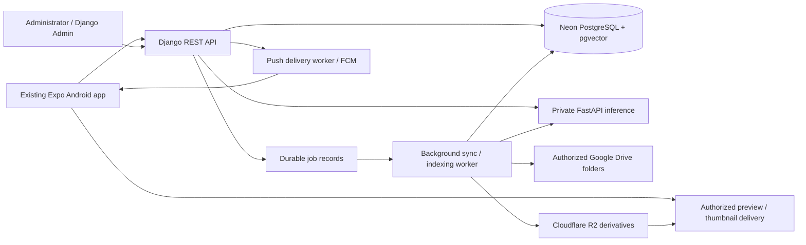

# Target architecture

This is the implementation design, not a description of running services. Use the existing frontend and implement one verified phase at a time.

## Boundaries

- **Frontend:** renders existing components, stores tokens securely, requests scoped APIs, and displays server-managed state. Never contains Drive, R2, database, service-authentication, or Firebase server credentials.
- **Django:** sole public product API and schema/migration authority. Owns authentication, access checks, content/admin, social actions, job records, vector searches, consent and audit trails.
- **FastAPI:** private authenticated image-to-embedding service with independently bounded inference concurrency. Returns detections/embeddings/model metadata only to trusted backend processes. No anonymous or mobile-direct endpoint.
- **Worker:** separate process for sync, image optimization, indexing, push delivery and cleanup. Persist job state/retries in PostgreSQL. Start with a modest database-backed queue/management-command worker; use a broker only when measured scheduling/retry needs justify it. Job claims, leases, bounded exponential retry and idempotency remain required.
- **Storage:** originals in Drive; optimized derivatives in R2. Public CDN URLs only for content explicitly designated public. Restricted events require private object delivery or expiring signed access and appropriately scoped cache behavior.

## Permissions

Use one canonical role field with exactly `Administrator`, `Faculty`, `Student` choices; it is not client-editable. A separate Role table is unnecessary unless it represents only these same immutable choices. Staff/superuser infrastructure flags must be kept consistent with the Administrator role and must never be writable through self-service APIs. Privileged endpoints and Django Admin check the product role as well as appropriate Django authentication/permission flags.

| Operation | Administrator | Faculty | Student |
| --- | --- | --- | --- |
| Manage events, photos, posts, spotlights, newsletters, announcements | Yes | No | No |
| Manage accounts, roles, event access, sync/indexing and moderation | Yes | No | No |
| Read published content / permitted photos | Yes, with management access | Scoped access | Scoped access |
| Edit own profile, like, comment, save, connect | Yes | Own permitted actions | Own permitted actions |
| Submit selfie search | Access + consent checks | Access + consent checks | Access + consent checks |
| Read/mark own notifications, register own device | Yes | Yes | Yes |
| Access Django Admin or management APIs | Yes | No | No |

Registration accepts Student/Faculty only. College membership and Faculty verification policy must be defined before enabling public registration; do not trust a chosen Faculty value as proof of employment. Profile updates whitelist editable fields. Deny role, ownership, publication and moderation field changes from unauthorized callers.

Enforce authorization through scoped querysets **and** action/object checks. Cover list/detail, nested routes, photo downloads, face search and result retrieval. A guessed photograph ID, a stored result, or an old notification must never bypass current event visibility. Published content has explicit draft/published/archived state and administrator attribution. Comments and profile edits are user actions, not publication privileges.

## Data model map

| Domain | Entities and key constraints |
| --- | --- |
| Accounts | User with role choices; one-to-one Profile; unique verified identity; deletion lifecycle |
| Events | Event, EventPermission; scoped audiences; publication/archive state |
| Photos | Photograph linked to Event; unique event/Drive-file mapping; source revision/hash; availability, derivative keys and indexing state |
| Sync | DriveSyncRun/cursor and per-file status; folder ownership, checkpoints, retries and error summaries |
| Content | Post, Spotlight, Newsletter, Announcement; admin authorship, visibility and publication metadata |
| Social | Like unique per user/post; Comment author and moderation state; Connection unique directed pair with no self-link; SavedCollection unique user/event |
| Notifications | Per-recipient Notification, PushDeviceToken and delivery status; invalid token removal and deduplication |
| Recognition | FaceEmbedding linked to photograph/event plus detection index, model/preprocessing version and vector; IndexingJob and FaceSearchJob with leases, retries and status |
| Privacy / audit | ConsentRecord with purpose, notice version, grant/withdrawal time; AuditLog with redacted actor/action/target metadata |

Add a 512-dimensional vector only when the selected model's output dimension is verified. Store every detected face separately. Do not add names/identity clusters to event embeddings. Django owns vector extension/schema migrations; FastAPI never migrates the shared database.

Index event/publication/date and photograph event/availability/order fields, notification recipient/read/time, and job status/scheduling keys. Use database uniqueness constraints for idempotency and interactions. Paginate collections, avoid N+1 queries with explicit related-data loading, and return thumbnail/preview metadata rather than original bytes.

## Drive and derivative lifecycle

1. Administrator links a folder available to a server-side authorized Drive identity. Store credentials in secret storage with least necessary provider access.
2. Worker enumerates files with pagination, records a sync run, and compares stable file ID plus revision/version/hash and relevant modification metadata. Reuse unchanged derivatives and embeddings.
3. Download only changed/new authorized images with byte, format, decode, pixel-count and timeout limits. Normalize orientation, strip unneeded metadata, and generate thumbnails/previews.
4. Write R2 objects under versioned keys. Save validated derivative metadata and enqueue a unique indexing job for that exact photo/model/revision.
5. Reconcile missing/deleted files only after a complete successful authoritative listing, or an explicit deletion signal. A partial listing, timeout or permission error must not mark every image deleted.
6. Tombstone deleted/unavailable photographs, revoke delivery, delete derivatives/embeddings as required, and record cleanup retries. API reads exclude tombstoned photos immediately.
7. Recheck availability and source revision before committing indexing results, preventing stale jobs from restoring deleted or replaced embeddings. Workers recover from expired leases and retry transient failures without creating duplicate photos/jobs.

Support administrator-triggered and scheduled sync with the same services. Log sanitized provider error codes and job IDs, never credentials or raw image content.

## Find My Photos

1. Index event photographs once per source/model/preprocessing version in the background, allowing multiple faces per photo. Record individual detections and quality failures. Do not reprocess the whole gallery during selfie searches.
2. Mobile submits a selected event, explicit purpose/versioned consent and a bounded selfie to Django. Django checks user status, current access, active consent, event availability and per-user/concurrency limits before inference.
3. FastAPI validates/decodes, detects, aligns and normalizes with the **same** model/preprocessing as indexing. Reject no-face, multiple-selfie-face and insufficient-quality cases rather than guessing.
4. Django queries only available photographs for the authorized selected event and matching model/version. Start with exact cosine search if measurements support it; choose approximate indexing only after recall and latency validation. Apply calibrated thresholds, deduplicate by photograph and recheck visibility before returning results.
5. Return authorized photo previews and scores as uncertain similarity candidates. No-match is a valid response; do not claim identification or guaranteed correctness. Search-job/result reads are requester-scoped.
6. Dispose of selfie data and transient search embeddings immediately after the operation. Account for upload spooling/temp files in both frameworks, error paths and worker cancellation. Persistent search metadata may retain status/timing and limited result references for a configured short period, but no selfie or query embedding.

Withdrawn consent cancels pending searches and deletes retained query artifacts/results for that purpose. Event-photo biometric indexing requires its own documented college authorization/notice and participant handling policy; search consent alone does not establish permission to index every attendee. Because gallery faces are not automatically named, do not promise account deletion alone can locate every depiction. Establish a photo/event-level takedown and biometric suppression workflow, delete associated embeddings, and prevent reindexing from recreating suppressed records. Event deletion removes its embeddings. Recheck consent and deletion state at job completion to handle races.

Model selection is blocked on proven licensing and held-out evaluation, as described in `../face_recognition/models/README.md`. No production recognition threshold or accuracy is asserted yet.

## Delivery, performance and release constraints

- Aim for 100 active users; define actual request mix and photo counts before benchmarking. Face-search concurrency is a separate CPU/memory capacity constraint.
- Persist notifications first, then deliver push idempotently. Decide whether Expo Push Service forwards to FCM or the backend sends directly to FCM; keep tokens typed and use one deliberate path. Validate Android notification behavior in a development/release build.
- Configure bounded database pools, bounded inference queues, timeouts, pagination and CDN derivatives. Add Redis caching/broker only for a measured need. Never globally cache private user/event responses without a correct authorization-aware key.
- Apply HTTPS, JWT refresh rotation/revocation, login/search throttles, secure server secrets, production host/origin restrictions, admin session/CSRF protection, upload validation, redacted logs and backups with tested restoration. Privileged users need an appropriate stronger authentication policy.
- Define retention periods in configuration and run auditable cleanup jobs, including backup aging and object storage cleanup. User deletion revokes sessions/device tokens, removes profile/private data and applies a documented policy to comments and audit records.
- Review applicable Indian privacy requirements, Google Play disclosures, account deletion and participant notices against current official guidance before release. This architecture is not a completed compliance assessment.
- Hosting, quotas, account ownership, cold starts and costs must be verified using actual provider accounts and measured usage; no always-on/free-tier guarantee is made.

## References consulted

- [Expo SDK 58 documentation](https://docs.expo.dev/versions/v58.0.0/) for the existing SDK boundary.
- [Django custom-user guidance](https://docs.djangoproject.com/en/5.2/topics/auth/customizing/#using-a-custom-user-model-when-starting-a-project) for defining the user model before initial migrations.
- [pgvector documentation](https://github.com/pgvector/pgvector) for exact/approximate search and cosine distance support. Index strategy remains subject to project benchmarks.
- [InsightFace licensing](https://github.com/deepinsight/insightface/tree/master/python-package#license) for distinguishing code and pretrained-model rights.
